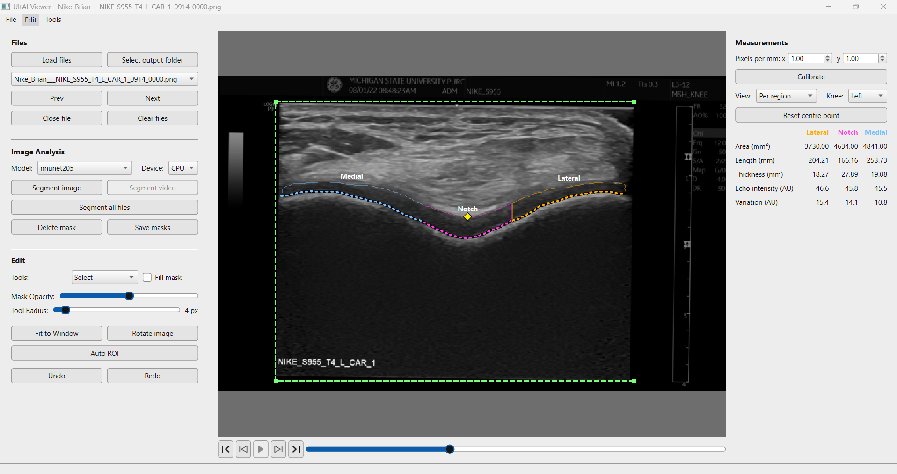

# UltAI Viewer User Guide

Version 1.1.0 (beta). For research use only; results need clinical validation.

## Install

- **Windows:** run `UltrAiViewer-v1.1.0-windows-x64-installer.exe`, then open **UltrAi Viewer** from the Start menu or the desktop.
- **Linux:** run `UltrAiViewer-v1.1.0-linux-x86_64` in the folder this guide is in.

Runs on the CPU; a 4-core CPU and 8 GB of RAM are recommended. macOS is not supported.

## Load and segment

1. Click **Load files** and choose images (PNG, JPEG, TIFF, BMP) and an output folder.
2. Choose a model under **Model** (nnunet recommended for highest precision).
3. Click **Segment image** for the image on screen, or **Segment all files** for all loaded images.
4. Correct the mask if needed with the tools under **Tools**. Ctrl+Z and Ctrl+Y undo and redo.

Scroll, use the arrow keys, or **Prev** / **Next** to move between images.

Masks are saved automatically as you go to `<output folder>/<model_name>_predictions/<image name>.png`. When you load a folder, they go in a subfolder named after it: `<output folder>/<model_name>_predictions/<input folder name>/<image name>.png`. Each video gets its own folder of frame masks named after the video.

## Compare models

1. Click **Compare models...** and tick two or more models. Their saved masks are shown side by side: 2 models in a row, 3 as two above one, 4 as a 2×2 grid, and so on.
2. Click **Segment image** to run every compared model on the image on screen. If some already have a mask, you are asked whether to overwrite them or run only the others.
3. All panels move together: changing image or frame, zooming (Ctrl+scroll) and dragging the image apply to every panel.
4. The **Measurements** panel shows the results of each model, in the same order as the panels.

Masks cannot be edited while comparing; click **Stop comparing** to edit again.

## Measurements

1. **Calibrate:** enter **Pixels per mm**, or click **Calibrate** and drag the lines onto a known distance. Until then the default of 1.00 is used, so the results are not real mm.
2. **View:** choose **Full cartilage** or **Per region** (lateral, notch, medial).
3. **Knee:** the side is read from the file name (`_L_`, `_R_`, `_left_`, `_right_`); if the name does not say, choose it.
4. **Notch centre:** if needed, drag the yellow diamond with the **Select** tool.
5. **Read the results** in the **Measurements** panel: area, length, thickness and echo intensity of the cartilage.

Measurements are saved automatically as you go to `<output folder>/<model_name>_predictions/measurements_<model_name>.csv`, one row per image. When you load a folder, the file is named `measurements_<model_name>_<input folder name>.csv`.

## Tips

- The models are most reliable when they see only the ultrasound field of view and the image is upright:
  - **Auto ROI** boxes the field of view on the current image or on all images. You can also draw a box with **ROI Box** under **Tools**. Boxes can be moved, resized or deleted.
  - **Rotate image** straightens a tilted image. The image file itself is not changed.

